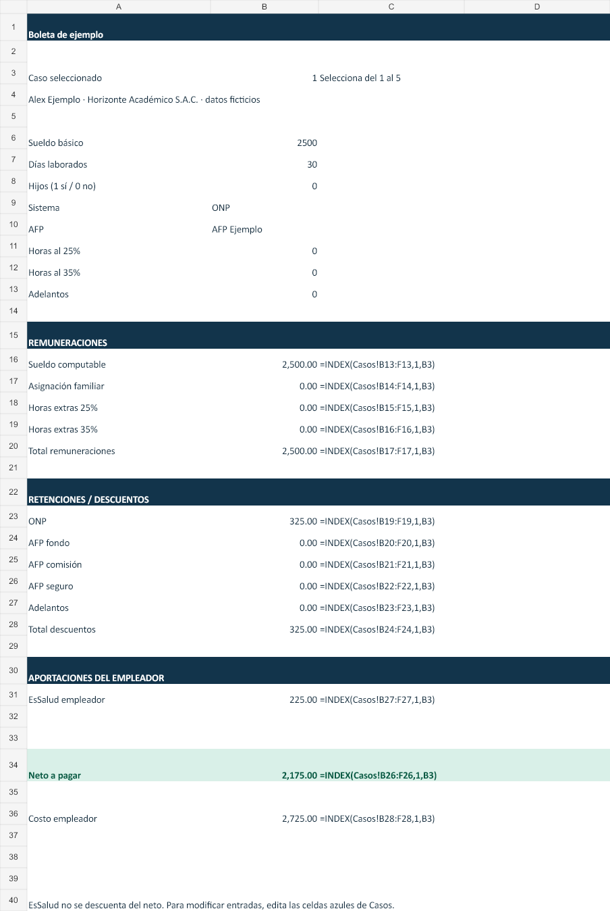
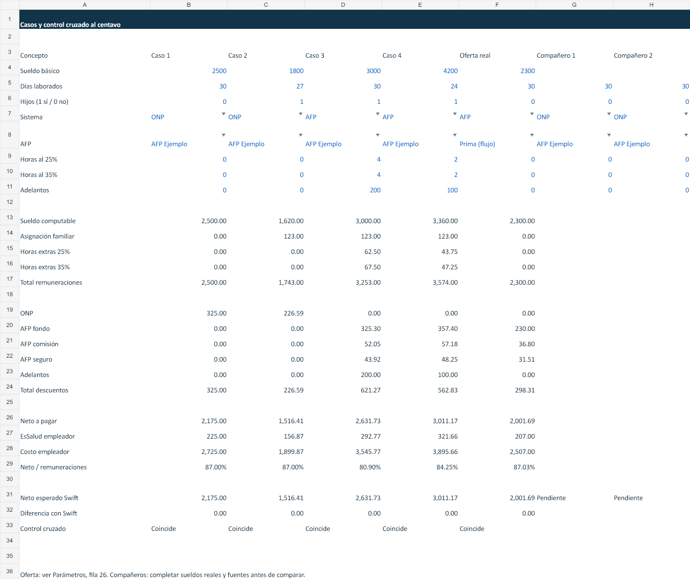

# Semana 09 · Boleta de pago

Aplicación de una sola pantalla en **Swift y SwiftUI**, con formulario, validación y boleta de ejemplo. Incluye Excel con cuatro hojas, análisis de las cinco preguntas y control cruzado del cálculo. Se implementan completos los niveles 1 y 2 y se añaden el encabezado ficticio y la comparación ONP/AFP.

## Abrir la app en la Mac

1. Abrir **`BoletaPago.xcodeproj`**, dentro de esta carpeta, con Xcode 16 o posterior.
2. Elegir el esquema **BoletaPago** y un simulador de iPhone con iOS 16 o posterior.
3. Ejecutar con **Cmd+R**. El paquete local `BoletaCore` está integrado; no hay que copiar archivos ni generar el proyecto.
4. Para probar en un iPhone físico, elegir el equipo de firma en Signing & Capabilities.

También se puede ejecutar `bash tools/validar-mac.sh`: corre las pruebas del motor y compila la app para simulador. El motor se compiló y ejecutó en Windows con Swift 6.3.3. La interfaz pasó análisis sintáctico con `swiftc -frontend -parse`; su compilación contra el SDK de iOS y su revisión en simulador quedan para la Mac.

## Uso

Ingresar sueldo, días, hijos y sistema de pensiones. Con AFP aparece su selector. Completar horas extras ya separadas en 25% y 35%, y adelantos. Pulsar **Calcular boleta** para mostrar los tres bloques y el neto debajo del formulario. El formulario acepta punto o coma decimal, sin separadores de miles, con hasta dos decimales.

Si hay datos inválidos se muestra un mensaje y no se emite una boleta. Cambiar cualquier entrada retira el resultado anterior para evitar mostrar cifras desactualizadas. Se muestran en cero los conceptos que no aplican. Los adelantos pueden producir un neto negativo; se explica como saldo pendiente.

La comparación ONP/AFP usa los mismos datos y la AFP seleccionada, que inicialmente es AFP Ejemplo. El encabezado dice **Boleta de ejemplo**, sin DNI ni RUC reales. No se calcula quinta categoría, que el enunciado excluye de las reglas generales y deja como reto opcional.

## Organización del código

| Archivo | Responsabilidad |
| --- | --- |
| `App/BoletaPagoApp.swift` | Entrada de la app SwiftUI. |
| `App/ContentView.swift` | Formulario, estados, validación visible, boleta y comparación. |
| `Sources/BoletaCore/Modelos.swift` | Structs, parámetros, diccionario AFP, arrays de conceptos y redondeo. |
| `Sources/BoletaCore/Boleta.swift` | Clase calculadora independiente de SwiftUI. |
| `Sources/BoletaCore/Formulario.swift` | Interpretación estricta de los campos del formulario. |
| `Tests/BoletaCoreTests/BoletaTests.swift` | Pruebas de casos, límites, redondeo y pensiones. |
| `Sources/BoletaCheck/main.swift` | Exporta los importes calculados por Swift para contrastar con Excel. |

Se usa `Decimal`, no `Double`, para el dinero. Se redondea cada concepto a dos decimales con redondeo comercial y después se suman los conceptos. El valor hora intermedio conserva su precisión. Todos los parámetros están en `Parametros` y en la hoja `Parámetros` del Excel, con fuentes y fecha.

## Excel

Abrir **[Boleta_Grupo_B.xlsx](outputs/semana09/Boleta_Grupo_B.xlsx)**.

- **Parámetros:** tasas, constantes, fuentes, fecha y oferta laboral.
- **Boleta:** seleccionar un caso de 1 a 5 en B3. Las fórmulas enlazan con el cálculo de Casos y se muestran también como texto al lado de los importes.
- **Casos:** cuatro ejercicios, oferta real y dos columnas para los datos de compañeros. Las entradas editables se muestran en azul. Todos los resultados se calculan mediante fórmulas; las cifras de control Swift son referencias independientes de la ejecución.
- **Explicación:** fórmulas en palabras, ejemplos numéricos y respuestas de análisis. Para ver las fórmulas de cálculo en sus celdas, activar **Fórmulas > Mostrar fórmulas** en Excel.

Las celdas de comparación con compañeros quedan vacías hasta recibir sus sueldos. Registrar también sus enlaces y fechas de consulta. Los valores de referencia Swift corresponden a los casos originales: si se cambian las entradas, una diferencia indica que ya no son esos mismos casos.

### Capturas del Excel generado

Estas imágenes son vistas del libro entregado, no capturas de una app ejecutada en iOS.





### Capturas de la app

La captura real de SwiftUI se completa al ejecutar el simulador en la Mac. Con la app visible, usar `bash tools/capturar-app.sh app-formulario`. Después de calcular los casos, capturar con `app-caso1`, `app-caso4` y `app-validacion`. Las imágenes se guardan en `docs/capturas/`. Esto permite documentar la ejecución real sin presentar una maqueta como evidencia.

## Validación realizada

Desde esta carpeta:

```sh
swift test
swift run boleta-check tools/verification.json
```

Resultado: **5 pruebas XCTest aprobadas, 0 fallos**. La exportación real de Swift se comparó con las fórmulas recalculadas del Excel: **70 importes coincidentes** entre los cuatro casos y la oferta propia. También se cambió el selector de los cinco casos y se modificó temporalmente el sueldo del caso 1 a S/ 2,600 para comprobar recálculo; luego se restauraron las entradas originales. Se inspeccionaron visualmente las cuatro hojas y se buscaron errores de fórmula.

| Caso | Remuneraciones | Descuentos | Neto | EsSalud |
| --- | ---: | ---: | ---: | ---: |
| 1 | 2,500.00 | 325.00 | **2,175.00** | 225.00 |
| 2 | 1,743.00 | 226.59 | **1,516.41** | 156.87 |
| 3 | 3,253.00 | 621.27 | **2,631.73** | 292.77 |
| 4 | 3,574.00 | 562.83 | **3,011.17** | 321.66 |
| Oferta propia | 2,300.00 | 298.31 | **2,001.69** | 207.00 |

Evidencia numérica: [control-cruzado.json](outputs/semana09/control-cruzado.json). No se afirma que la compilación o la ejecución de la interfaz iOS se hayan realizado en Windows.

Para regenerar el libro, primero ejecutar `swift run boleta-check tools/verification.json` y después `node tools/crear-excel.mjs` con `@oai/artifact-tool` disponible. El archivo Excel entregado funciona por sí mismo y no necesita ese generador.

## Análisis y exposición

- [Respuestas y caso 4 resuelto](docs/ANALISIS.md).
- [Tabla de fuentes y alcance de las tasas](docs/FUENTES.md).
- [Guía de exposición para dos participantes](docs/EXPOSICION.md).

## Siete hitos de Git

1. Modelo: datos de boleta y parámetros centralizados.
2. Cálculo: remuneraciones, ONP, AFP, EsSalud y neto con Decimal.
3. Validación: casos de prueba y entradas inválidas con XCTest.
4. Interfaz: pantalla SwiftUI y comparación de pensiones.
5. Proyecto: app iOS y esquema de Xcode compartido.
6. Excel: cuatro hojas y contraste de 70 importes con Swift.
7. Documentación: análisis, fuentes, capturas del Excel y guía de exposición.

Los commits se pueden revisar con `git log -7 --oneline`. Todo el trabajo de esta actividad está dentro de Semana09.
